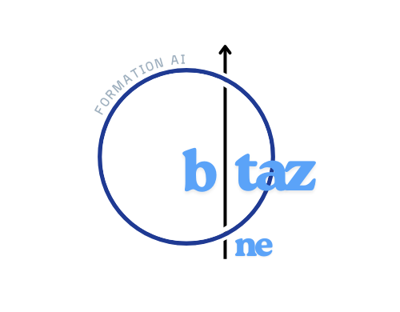
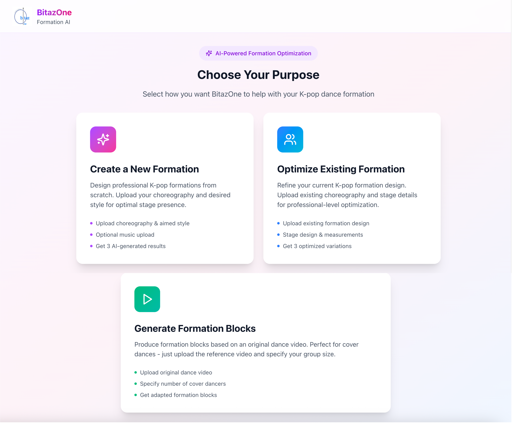
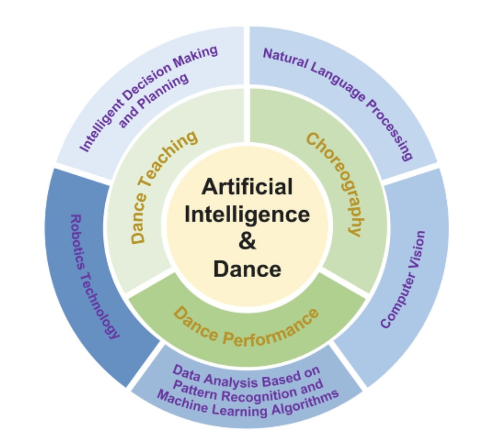
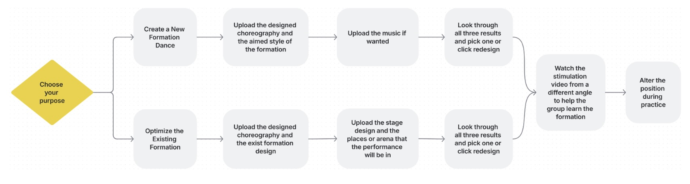
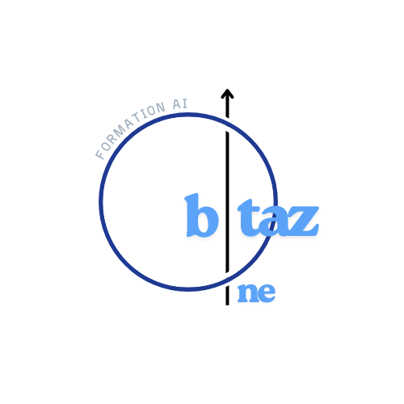
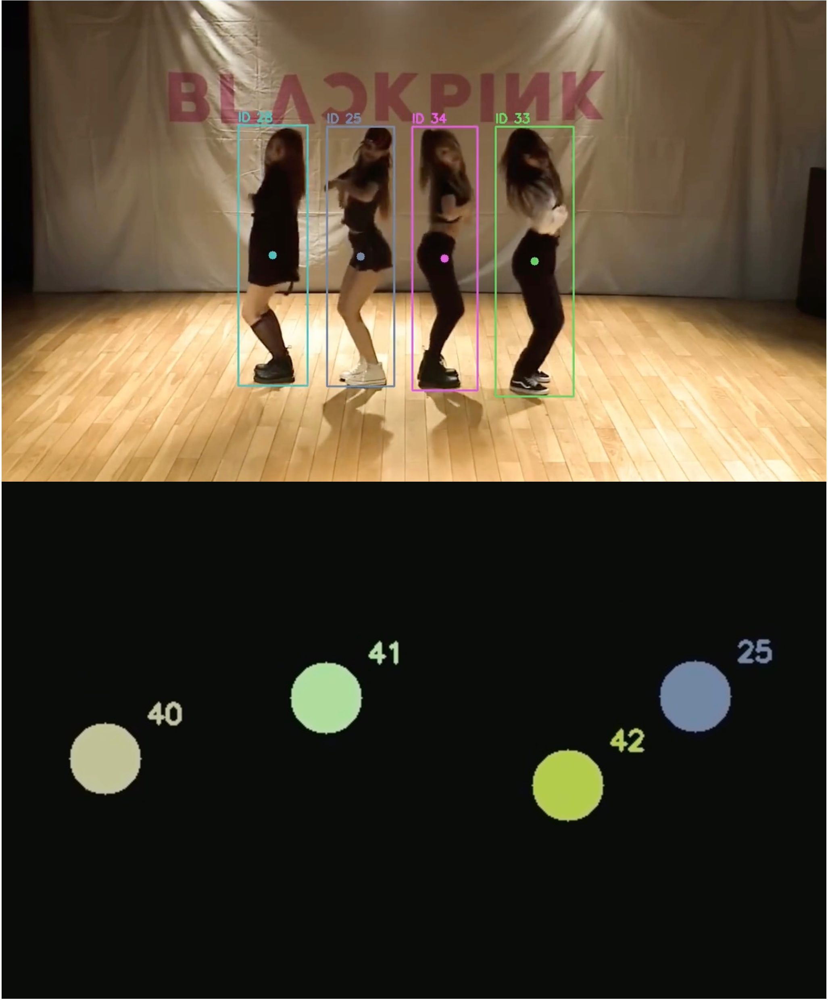

# BitazOne

Original page: https://misharau.myportfolio.com/bitazone · 2025

UX Design | Website Develop & Design  
An website prototype that can create new dance formation, optimize existing dance formation, and generate dance formation blocks for dance groups. ​​​​​​​

Background  
A documentary called SEVENTEEN: Our Chapter was released and the problem of figuring out the dance formation for different performances, especially when some members will be going to the army or have other activities in other countries is stated. Also, dance cover groups are facing the issue of putting so much effort and time to just create dance formation blocks according to the dance practice video. It soon came to mind that what if there is an AI system that helps the members and the choreographers to design the dance formation change and create the dance blocks.

Research  
There are existing databases on Kpop dance moves already. The dance moves are recognized as different points, lines, and x, y positions, replacing the actual people movement. This gave me an idea of how I could interpret human movement into different point looking from the top. I also interviewed two member from a Kpop dance group, GGWB, at UMD and learned that as a dance cover group, they do not need a high ability to design the formation changes, but still need to deal with situations when the formation from the original group does not work.

Ideation  
I used a flow chart to organized my though on how different pages will get connected together through different button and how the design can provide a smoother experience for users.  
I also created the logo and name of the website. The big round emphasizes being one in a team. The arrow represents individuals are important too in a team. “Bitaz” comes from the “Bita-Zoroi”, which is perfectly synchronized in Japanese.

Coding  
After creating the prototype, I started using Python to code to grab the human movement from a dance video and turn it into a top-view video that have all the dance formation change blocks. A video that tracks each the positions in the original video and a video of top-view positions are created after running the code.

Future Work  
The project is still in development. In the next phase, I want to improve the accuracy of the top-down view video that is being generated. Also, the numbers beside the dancing blocks are not in order and are not fixed, which makes it harder to recognize the positions for the same person.
