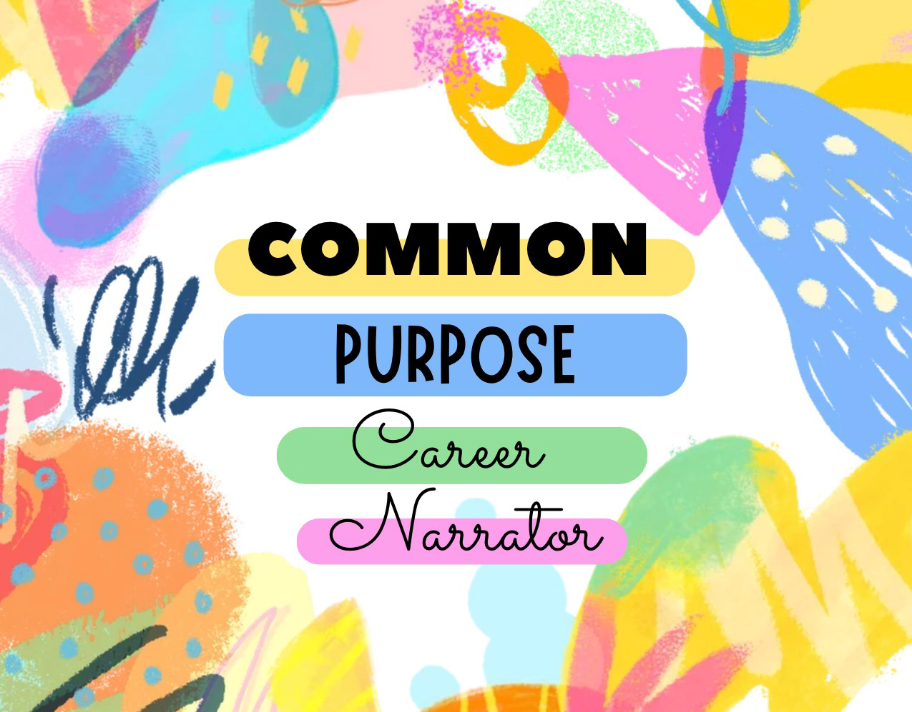
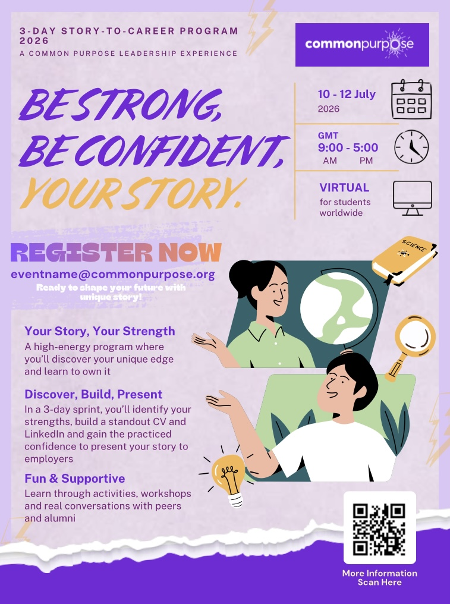
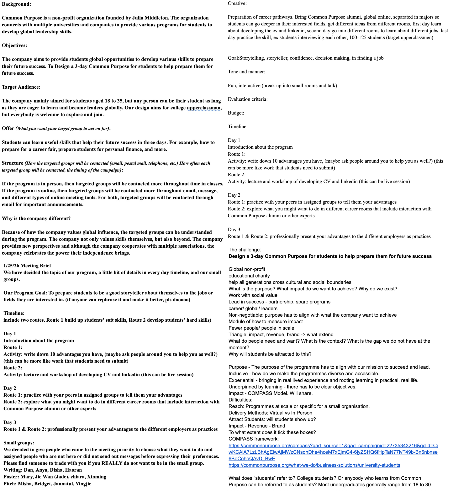

# Career Narrator

Original page: https://misharau.myportfolio.com/career-narrator · 2026

Program Design | Students Experience Design  
An international online program that provides opportunity for students around the world to be convincing storytellers about themselves in the jobs or fields they are interested in.

*Poster of the Program*

Brainstorming  
We are randomly separated in to different teams and given the same challenge of designing a 3-day Common Purpose program for students to help prepare them for future success. Because the program can be about different themes, we discussed based on what we experience in our college. After we decided the theme, we brainstormed about what specific activities we want to include. Because of the different timezones we are in, we made meeting notes for teammates who are not there.

Illustration  
We created a poster, a presentation slide, and a written explanation to illustrate the program we designed.

**Presentation Slide:** https://www.canva.com/design/DAG_ncfbQGM/8jKTvdYUN9ggx-KyOPnGYA/view?embed
