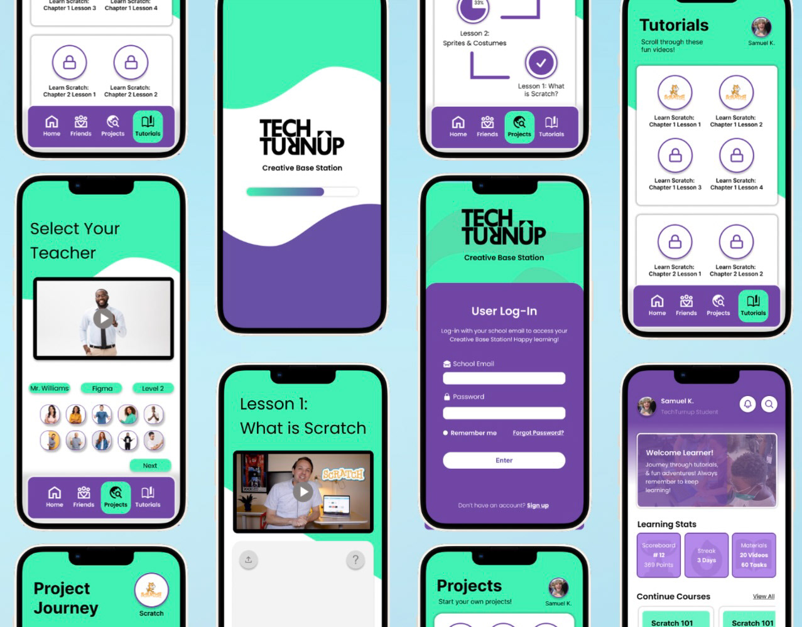
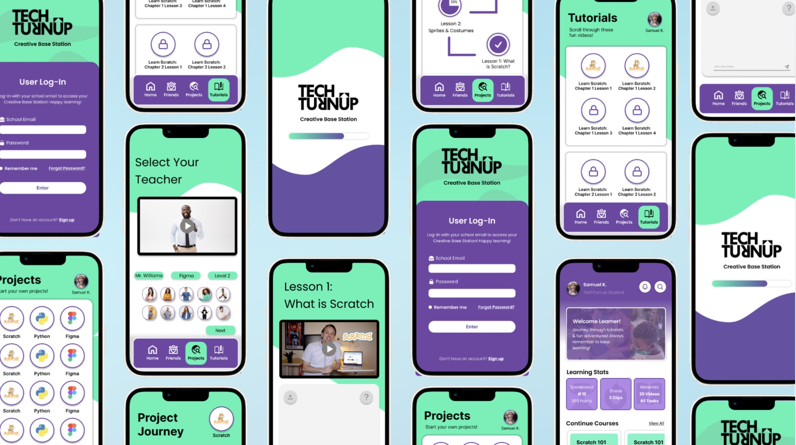
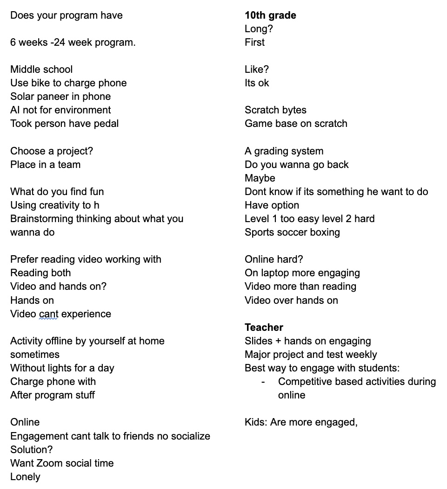
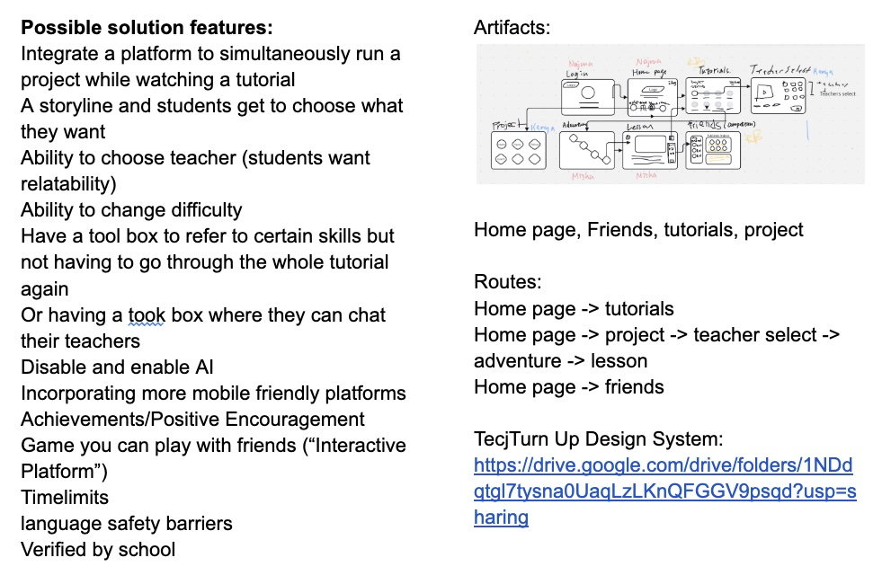
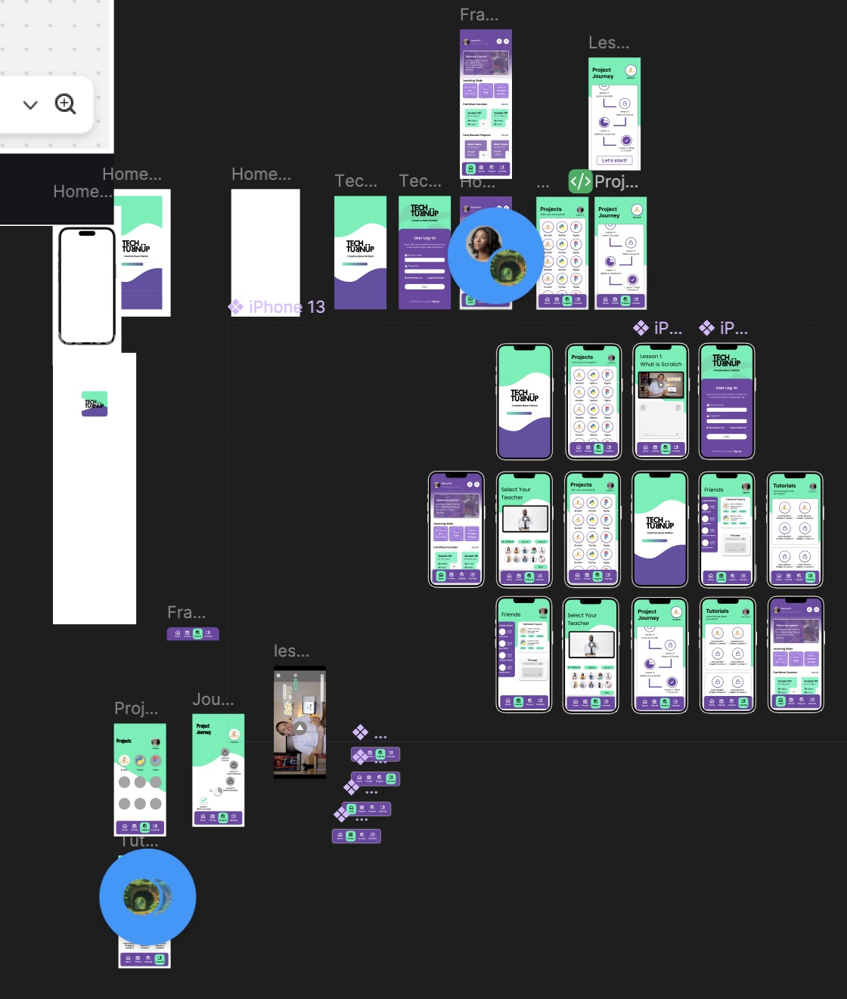

# Tech Turn Up Creative Base Station

Original page: https://misharau.myportfolio.com/tech-turn-up-creative-base-station · 2026

UX Design | App Design  
An mobile app prototype that allows students from Tech Turn Up to stay connected with the community after being done with their classes.

Background  
There are community gap, identity gap, and access gap for students after they finish their classes. Tech Turn Up lacks structured programs online, halting momentum in student learning once the program ends. Most online learning platforms are passive, Tech Turn Up wants students to feel integrated in the community as creators and collaborators. Some students cannot attend the program in-person, restricting them from valuable development and creative experiences.

Research  
We interviewed facilitators, high school students, elementary school students, and teachers for their perspectives on what they want an online platform to include.

Ideation  
After we brainstormed about what elements we want to be included in the design, we each designed our own version on sketch and combined our design together.

Prototype  
We created the prototype via Figma according to the combined sketch. First, we made sure all the functions we considered are included in the prototype. Then, we used the Tech Turn Up color palette to beautify the interface.

Reflection  
If we would have more time, we would include the design of a website, so students with computer can easily access to the platform as well. We would also think more about how all the coding platform can be embedded in the mobile app since some popularly used coding language cannot be used via a phone app or website.

**Presentation Slide:** https://www.canva.com/design/DAHFVsekIuM/198PdZeUU4vhY6op9vGYXA/view?embed
